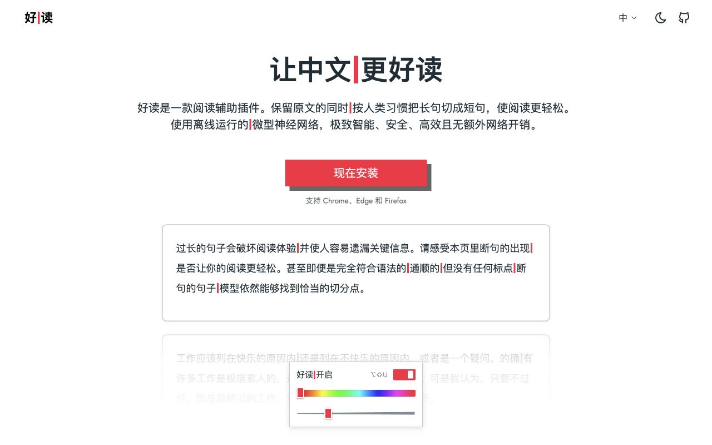

<h1>
  <picture>
    <source media="(prefers-color-scheme: dark)" srcset="release/assets/haodu-wordmark-dark.svg">
    
  </picture>
</h1>

让中文更好读

好读是一款中文阅读辅助插件，在保留原文的基础上，将长句划分为短句。<br>
微型神经网络在浏览器本地运行，无需联网推理。

[安装使用](#安装使用) · [开发文档](docs/development.md) · [问题反馈](https://github.com/77Vincent/haodu/issues)



## 安装使用

本地开发需要 Node.js 24.13+ 和 `zip`（macOS 自带），无需安装 npm 依赖。

```sh
git clone https://github.com/77Vincent/haodu.git
cd haodu
```

按浏览器选择构建命令，以下命令均在仓库根目录执行。

### Chrome

```sh
npm run release:extension
```

Chrome 113+：打开 `chrome://extensions/`，开启**开发者模式**，点击**加载已解压的扩展程序**，选择 `dist/extension/`。调试本地 HTML 时，在扩展详情中开启“允许访问文件网址”。

### Safari

```sh
npm run release:safari
```

使用支持[临时扩展](https://developer.apple.com/documentation/safariservices/running-your-safari-web-extension)的 macOS Safari：在“设置 → 高级”开启网页开发者功能，再到“开发者 → 添加临时扩展”选择 `dist/safari-extension/`。按提示授权，在“扩展”中启用好读并允许访问测试网站。

### Firefox

```sh
npm run release:firefox
```

桌面 Firefox 140+：打开 `about:debugging#/runtime/this-firefox`，点击**临时载入附加组件**，选择 `dist/firefox-extension/manifest.json`，允许访问测试网站。退出浏览器后需重新载入。

加载后打开中文网页，点击工具栏中的好读图标，在面板中开启「阅读辅助」，也可调整分隔线颜色和粗细。

> 默认快捷键：macOS 使用 **Option + Shift + U**（⌥⇧U），其他平台使用 **Alt + Shift + U**。

## 开发与贡献

本仓库包含浏览器插件、模型推理代码和展示站点。已内置训练好的模型，开发和测试无需训练数据。实现说明见 [架构与实现](docs/architecture.md)，调试方法见 [开发与测试](docs/development.md)。

修改扩展代码后，运行测试：

```sh
npm test
```

随后重新运行对应浏览器的构建命令，在浏览器中重载扩展并刷新测试网页。

欢迎提交 Pull Request 或通过 [Issues](https://github.com/77Vincent/haodu/issues) 反馈问题；请附上复现步骤、相关例句和浏览器版本。

## 文档

- [架构与实现](docs/architecture.md)
- [网站开发](site/README.md)
- [隐私政策](site/content/privacy.md)
